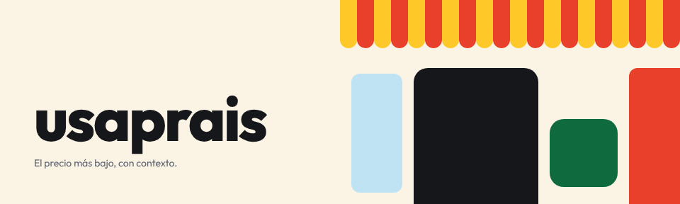
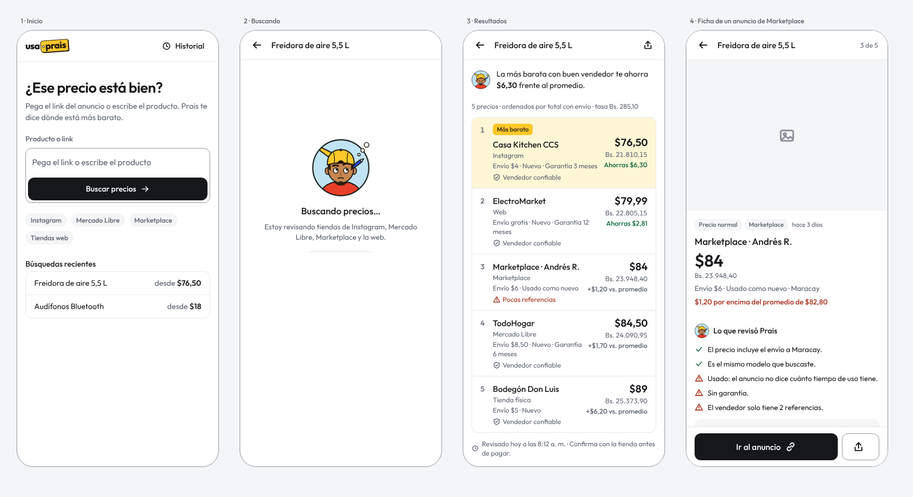
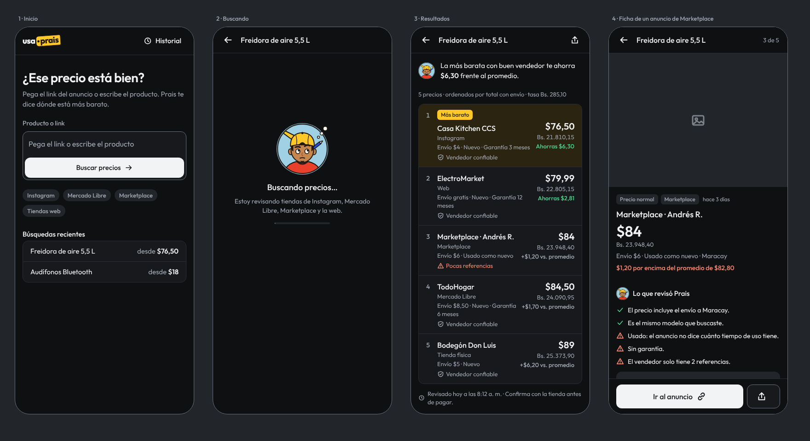
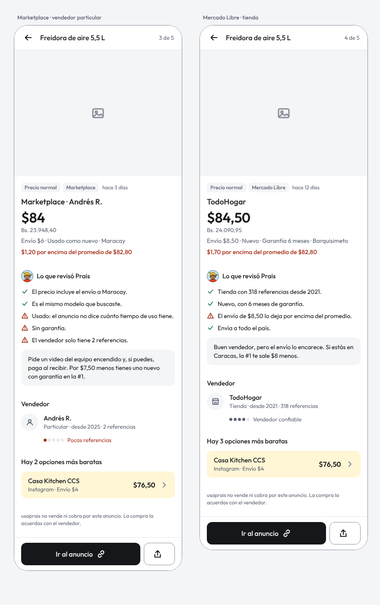
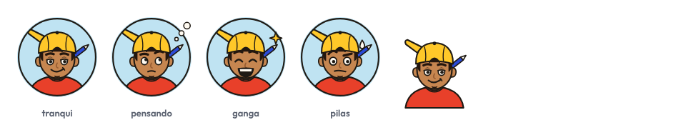
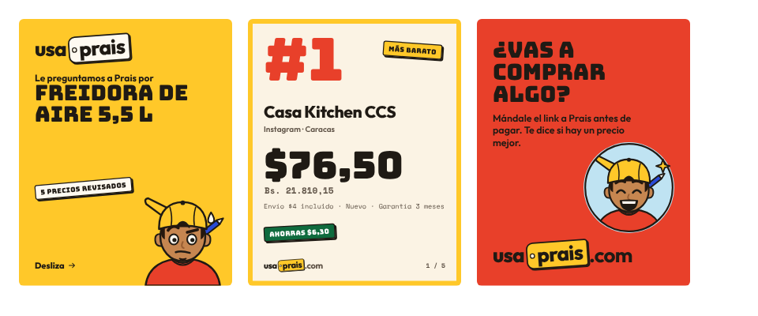

# Sistema de diseño de usaprais



Identidad visual, componentes y reglas de uso de usaprais y de su personaje, Prais. La versión navegable, con los componentes en vivo y los tokens editables, está en Claude: [sistema de diseño en Claude](https://claude.ai/artifact/VzZpm1h7X9h1Nww2dPZjWu) (privado hasta que se comparta desde su menú *Share*).

## Contenido

| Ruta | Qué es |
|---|---|
| [`tokens/tokens.json`](./tokens/tokens.json) | Colores (temas `papel` y `noche`), tipografía, espaciado, radios, sombras y grosores |
| [`tokens/tokens.css`](./tokens/tokens.css) | Los mismos tokens como variables CSS (`--tinta`, `--space-4`…), con `[data-theme="noche"]` para el tema oscuro |
| [`components/`](./components) | `bundle.js` (expone `window.Prais`), `bundle.css` y los tipos en `index.d.ts` |
| [`componentes.md`](./componentes.md) | Guía de uso de cada componente |
| [`prais.md`](./prais.md) | El personaje: personalidad, voz, estados y reglas de ilustración |
| [`canales.md`](./canales.md) | Cómo se adapta el resultado a la web, WhatsApp, X e Instagram |
| [`assets/`](./assets) | SVG de Prais en sus cuatro estados (con y sin círculo) y el isotipo |
| [`demo.html`](./demo.html) | Página de ejemplo que carga el sistema y pinta las pantallas móviles |

## Pantallas



<details>
<summary>Tema oscuro</summary>



</details>

| Ficha de oferta | Prais | Carrusel de Instagram |
|---|---|---|
|  |  |  |

## Uso rápido

```html
<link rel="stylesheet" href="docs/design-system/tokens/tokens.css">
<link rel="stylesheet" href="docs/design-system/components/bundle.css">
<script src="https://cdn.jsdelivr.net/npm/react@18.3.1/umd/react.production.min.js"></script>
<script src="https://cdn.jsdelivr.net/npm/react-dom@18.3.1/umd/react-dom.production.min.js"></script>
<script src="docs/design-system/components/bundle.js"></script>
<script>
  const { RankedList } = window.Prais;
  ReactDOM.createRoot(document.getElementById('app')).render(
    React.createElement(RankedList, { producto: 'Freidora de aire 5,5 L', ofertas, tasa })
  );
</script>
```

`bundle.css` importa Outfit, Bungee y Space Mono desde Google Fonts. Para el tema oscuro, pon `data-theme="noche"` en `<html>`.

Los valores fuente están en `tokens.json`. Si cambias un token en el sistema de Claude, vuelve a exportar `tokens.json` y `tokens.css` aquí.

## Brand book

usaprais le dice a la persona si el precio que tiene enfrente es el mejor posible. Le das un producto o un link y Prais —el pana pilas que ya recorrió todas las tiendas— te devuelve una lista ordenada del más barato al más caro, con la información que necesitas para decidir.

Es para jóvenes en Venezuela que quieren pagar lo menos posible en un mercado donde el mismo producto tiene diez precios distintos: en Instagram, en Marketplace, en Mercado Libre, en la tienda de la esquina. La identidad viene de ahí —el cartel pintado a mano de la bodega, el papel kraft, el precio escrito con marcador grueso—, pero la herramienta en sí es sobria: comprar es una tarea, y la interfaz no debe competir con los precios.

### Dos capas: marca y producto

| | **Marca** (expresiva) | **Producto** (sobrio) |
|---|---|---|
| Dónde | Campañas, carrusel de Instagram, hero de la landing, portada, estados con Prais (carga, vacío, error) | Búsqueda, resultados, ficha de oferta, ajustes |
| Fondo | `kraft` | `papel` (blanco) y grises fríos (`papel-bajo`, `linea`) |
| Precios | Bungee (`display`) | Outfit 700 con números tabulares (`precio-ui`, `precio-ui-lg`) |
| Etiquetas | `Sticker`: torcido, borde grueso, sombra dura | `Badge`: plano, derecho, sin borde |
| Botones | `Button variant="cartel"` | `primario` (negro), `secundario`, `fantasma` |
| Bordes y sombras | `grosor-cartel`, `sombra-sticker`, `sombra-cartel` | `grosor-fino` en `linea`; sin sombras |
| Prais | Ilustrado, grande, protagonista | Avatar pequeño junto a una línea, o `EstadoPrais` cuando no hay contenido |

Regla: si una pantalla muestra precios para comparar, es producto. En el producto, el amarillo `sol` aparece solo en el logo y para marcar la oferta más barata; así, cuando aparece, significa algo.

### Principios

1. **El más barato, con contexto.** El ranking es siempre por precio total con envío, de menor a mayor. Al lado de cada precio va lo que hace falta para decidir: envío, condición, garantía, confianza del vendedor.
2. **Dólares primero, bolívares siempre.** La gente piensa en dólares y paga en bolívares. Cada precio en dólares lleva su equivalente en Bs. debajo y la tasa usada a la vista.
3. **De tu lado.** Prais no vende nada ni tiene tiendas favoritas. Si la opción más barata tiene un vendedor dudoso, lo dice.
4. **Tan rápido como un mensaje.** La respuesta cabe en un globo de chat. El detalle está a un toque, nunca antes del veredicto.

### Voz y tono

Prais es el pana pilas: atento, directo, de tu lado. Habla en **neutro cercano**: tuteo, frases cortas, cifras concretas, sin jerga regional fuerte. La actitud es de calle; el vocabulario lo entiende cualquiera.

| Sí | No |
|---|---|
| "Encontré 5 precios. El mejor está $6,30 por debajo del promedio." | "¡¡Wow!! 🔥 Increíble oferta para ti 🔥" |
| "Ojo: $109 está 32% por encima de lo que cobran otras tiendas." | "Este precio podría no ser el más competitivo del mercado." |
| "Pocas referencias: pide un video del equipo funcionando antes de pagar." | "Vendedor no verificado. Proceda bajo su propio riesgo." |
| "Revisado hoy a las 8:12 a. m. · Confirma con la tienda antes de pagar." | "Los precios mostrados son referenciales y están sujetos a cambios." |

- Escribe la cifra, no el adjetivo: "$6,30 menos" en vez de "mucho más barato".
- Mayúscula solo al inicio de la oración y en nombres propios. Los textos en `display` (Bungee) salen en mayúsculas solos; no los escribas en mayúsculas en el código.
- La marca se escribe **usaprais**, siempre en minúscula y junta. El personaje es **Prais**.
- Números en formato venezolano: punto de miles y coma decimal ("$1.249,99", "Bs. 21.810,15"). Usa `Prais.formato.usd()` y `Prais.formato.bs()`.
- Sin emojis en la web. En canales de chat, máximo uno por mensaje y nunca en lugar de una palabra.
- Nunca inventes urgencia ("¡solo por hoy!"). El tono de Prais es el de alguien que te ahorra plata, no el de alguien que te la quiere sacar.

### Color

- **Producto:** fondo `papel`, tarjetas y listas en `papel-alto` con borde de 1px en `linea`. Texto en `tinta`; detalles en `tinta-suave`. Los controles (campos, botón secundario) llevan borde `borde`.
- El botón principal es `accion` (casi negro en claro, gris muy claro en noche) con texto `on-accion`. No uses `sol` para botones del producto.
- `sol` en el producto: solo el logo, el badge "Más barato" y el fondo `sol-tinte` de la fila #1.
- Veredicto: `ahorro` sobre `ahorro-tinte` para "Buen precio"; `caro-texto` sobre `caro-tinte` para "Está caro". Siempre con palabra e ícono; el color nunca es la única señal.
- `anil` para enlaces. `foco` para el anillo de teclado.
- **Marca:** `kraft` de fondo, `sol` y `tomate` en bloques grandes, `trazo` para bordes de cartel, `caro` para el sticker de "Está caro", `cielo` como alivio.
- Los colores de Prais (`prais-*`) son fijos en ambos temas.

### Tipografía

- **Outfit** (`sans`): toda la interfaz del producto y el logo. Pesos ligeros: títulos y precios en 600, nombres de tienda y botones en 500, texto en 400. Nada en 700 u 800 salvo el logo. Precios con números tabulares (`precio-ui`, `precio-ui-lg`), detalles en `meta`, badges en `badge`.
- **Bungee** (`display`): solo capa de marca. Titulares de campaña, precios en slides y stickers. Nunca en listas de resultados ni fichas.
- **Space Mono** (`mono`): solo capa de marca, para el efecto de ticket de caja en slides y piezas impresas.

Mayúscula solo al inicio de la oración, también en badges y botones.

### Forma, espacio y profundidad

- **Producto:** bordes de 1px (`grosor-fino`), sin sombras en tarjetas ni botones. Las listas son una sola tarjeta con filas separadas por `linea`, no tarjetas sueltas. Radios: `radius-sm` para badges, `radius-md` para botones, campos y listas, `radius-pill` para chips. Nada va torcido.
- **Marca:** `grosor-cartel`, sombras duras (`sombra-sticker`, `sombra-cartel`) y stickers inclinados entre -5° y 4°, como pegados a mano.
- **Espaciado:** escala de `space-1` (4px) a `space-8` (72px). En móvil, márgenes laterales `space-4`; filas con `space-4` de padding; secciones de una ficha separadas por `space-6`.
- **Layout:** móvil primero. Resultados en una columna de máximo 720px; ficha de máximo 480px (en desktop, como panel lateral). Los componentes se adaptan a su contenedor, no a la pantalla.

### Iconografía

Set propio en `Icon`: 24×24, trazo 2.25px, puntas redondas, `currentColor`. El trazo grueso combina con los bordes de cartel. Siempre junto a una palabra; los botones de solo ícono llevan `label`. Las plataformas de venta (Instagram, Mercado Libre, Marketplace) se nombran en texto dentro de un `Chip`, sin sus logos.

### Movimiento

- Producto: solo cambios de color en hover y la barra de carga de `EstadoPrais`. Respeta `prefers-reduced-motion`.
- Mientras busca, Prais está `pensando`; al terminar, la línea de resumen usa `ganga` o `pilas` según el resultado.
- Marca: el botón `cartel` se hunde 3px al presionar; los stickers pueden entrar con un rebote leve en campañas.

### Accesibilidad

- Todo texto cumple 4.5:1 sobre el fondo que nombra su token, en ambos temas; ver la nota de cada color.
- El foco de teclado es un anillo sólido de 2px en `foco` con 2px de separación.
- Los veredictos se leen sin color: el sticker dice la palabra y lleva ícono.
- Prais tiene texto alternativo según su estado; los slides de Instagram llevan la misma información en el texto del DM.

### Usar el sistema

Los componentes viven en `components/bundle.js` como `window.Prais` y esperan React 18 en la página. Carga `components/bundle.css` después de `tokens.css`; el CSS importa las tres familias desde Google Fonts. Todo lo que hace falta para pintar un resultado está en `RankedList` y `FichaOferta`; para carga, vacío y error, `EstadoPrais`; para los canales de chat, `Prais.textoParaCanal(canal, datos)`.
